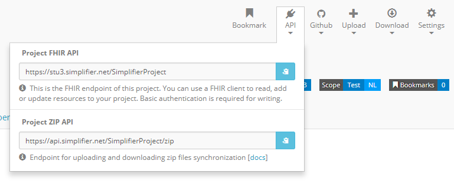

.. _simpl_endpoint:

Project FHIR API and ZIP
========================

Every Simplifier.net project has a FHIR API and a ZIP endpoint you can use to read and manage its contents programmatically. Both accept a :doc:`JWT token </api/authentication>`. For authentication, the Postman collection, and the other Simplifier APIs, see the :doc:`API section </api/api>`.

.. contents::
  :depth: 1
  :local:

Project FHIR API
----------------

The endpoint of a Simplifier.net project can be used to search for resources in the project
or to read, create and update resources with a FHIR client. History
searches are also supported. To retrieve the endpoint of a project in Simplifier,
click on ``API`` in the top right menu when visiting either the
:ref:`project <project-page>` or :ref:`resource <resource-page>` page.
The image below shows the location.

It supports all the API operations like reading, creating or deleting a resource and search.

You can also use this to point `Firely Server <https://docs.fire.ly/projects/Firely-Server/en/latest/>`_
to a Simplifier.net project via the FHIR API to import the conformance resources.
Either via a (manual) import operation or by configuration
of the project's endpoint and authentication in the appsettings.

Project ZIP API
---------------

The project ZIP API is available at project level. You can use the ZIP endpoint
for synchronization of a complete project. With an HTTP tool you can use
GET or PUT on https://api.simplifier.net/<yourproject>/zip to retrieve or
update your project in zipped form.

