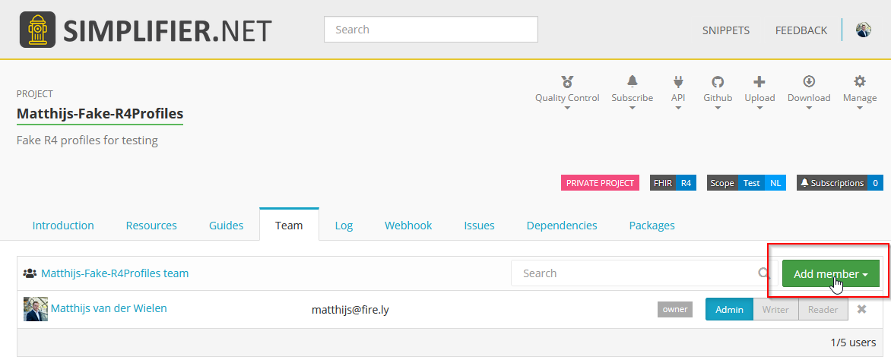
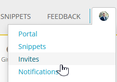
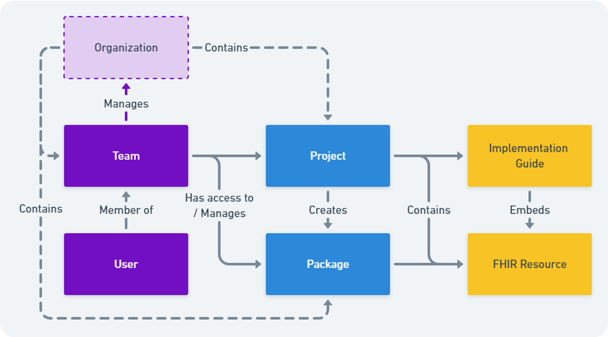
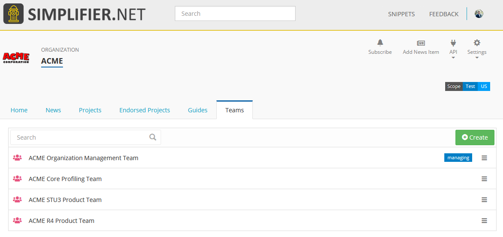
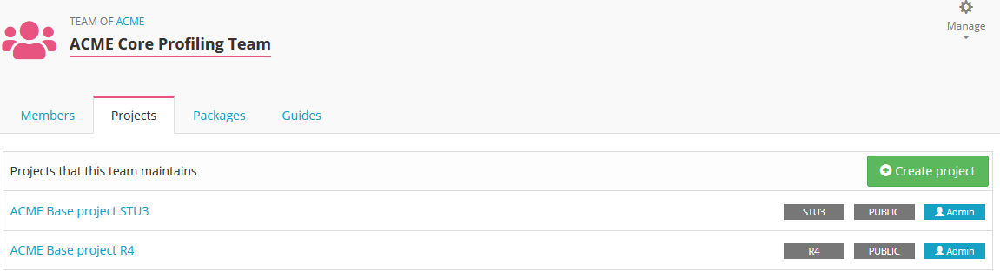
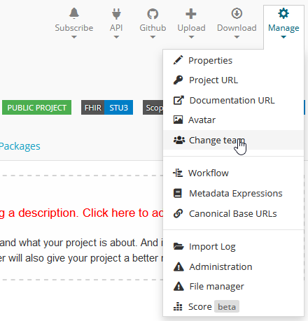

.. _Team_Management:

Team Management
^^^^^^^^^^^^^^^

.. important::

  This feature is available from the Team plan and up. `See the pricing page for details. <https://simplifier.net/pricing>`_

In your project, the license holder and Admin users can add more Team members. Under the ``Team`` tab you can add more Team members by inviting them by entering a valid emailaddress. 





    
The invited Team member will receive an email informing them they have been invited to join a project. Under the ``Invites`` tab the user can accept the invite.


Team license
------------

When adding new team members to your project you have the option to assign "Admin", "Writer" or "Reader" rights to the users. You can change these rights at any time should someone's function change. In the table below the difference between these rights is explained. 

.. list-table:: Team member rights (Team license)
  :widths: 20, 10, 10, 10, 10, 10, 10
  :header-rows: 1

  * - Rights
    - View
    - Edit  
     
      resource
    - Access 
     
      IG Editor
    - Forge 
     
      Sync
    - Manage 
     
      Team
    - Change Project 
     
      ownership
    

  * - Reader
    - ✔️
    - 
    - 
    - 
    -   
    - 

  * - Writer
    - ✔️
    - ✔️
    - ✔️
    - ✔️
    - 
    - 


  * - Admin
    - ✔️
    - ✔️
    - ✔️
    - ✔️
    - ✔️
    - 


  * - Project owner
    - ✔️
    - ✔️
    - ✔️
    - ✔️
    - ✔️
    - ✔️


.. _hide_team_members:

Hide team members
-----------------

By default, anyone who can see a project can also see who is in its team. Team admins can hide the members from everyone outside the team:

1. Open the ``Team`` tab of the project and click ``Configure team``.
2. On the ``Team settings`` page, turn off ``Show team members publicly`` and click ``Save``.

Members of the team are then hidden from everyone who is not a member: on the ``Team`` tab, and wherever Simplifier would otherwise show their name, such as the project log, the file history and user profiles. Team members still see each other as before. Existing teams stay public until you change this setting.

Last login of team members
--------------------------

The team owner, marked ``owner`` in the member list, sees on the ``Team`` tab when each member last logged in to Simplifier, in a ``Last login`` tag next to the member. It shows a range rather than a date: this month, within 3 months, within a year, over a year ago or over 2 years ago. Use it to find members who no longer need their access.

Enterprise license
------------------

Enterprise licenses allow you to create an :ref:`Organization <Organization_page>`. Inside your Organization project teams can be managed the same as with the Team license. 



Additionally, for Enterprise licenses the Team management feature is available. You can access this through the ``Teams`` tab in your Organization portal. 

Create Teams
````````````
In the Teams section Multiple teams can be created and managed. There are two types of teams available, the managing team and project teams. You can create multiple project teams, but only one management team. The managing team members with Admin rights are given the same rights as the license owner. They will be allowed to create projects under the Organization and manage the Organizations project teams. One more benefit of adding people to the Managing team is that you can easily add them to other teams in the Organization. They are shown in the dropdown for adding members and don't even need to accept the invite anymore.




Team projects
`````````````
If you click on a create Team you will see the team portal. This gives an overview of the projects the Team is working on as well as the created packages and Implementation Guides. From this portal new projects can be created for that team to work on. 
In existing projects, the created project teams can be assigned as a whole to a project. 




Team assignment can be done in the project page. Navigate to ``Change team`` and in the next screen select the Team you want to have assigned to the project. 




.. _guest_users:

Guest users
```````````
With an Enterprise license you can invite people as a ``Guest``, for example external reviewers, partners or customers who need to see your work but not take part in it. Guest is a role you choose when you invite someone to a team, next to ``Reader``, ``Writer`` and ``Admin``.

A guest gets read access to the private content of the team they are invited to:

- the team's private projects and their resources
- the team's implementation guides, including published versions
- the team's packages

Access is limited to that one team. Being a guest in one team gives no access to the projects, guides or packages of other teams in your Organization, and a guest is not a member of the Organization. To give a guest access to more content, invite them to each team that needs it.

A guest has less access than a ``Reader``. On private projects, guests cannot:

- see the project ``Log``
- view or create issues
- see unlisted package versions or private package feeds

Guests are also kept out of sight. They do not appear on the ``Team`` tab for visitors who are not logged in or for other guests, so external parties do not see who else has access. Readers, Writers and Admins of the team still see the guests in the member list.

Guests count toward the maximum number of members of your team.


