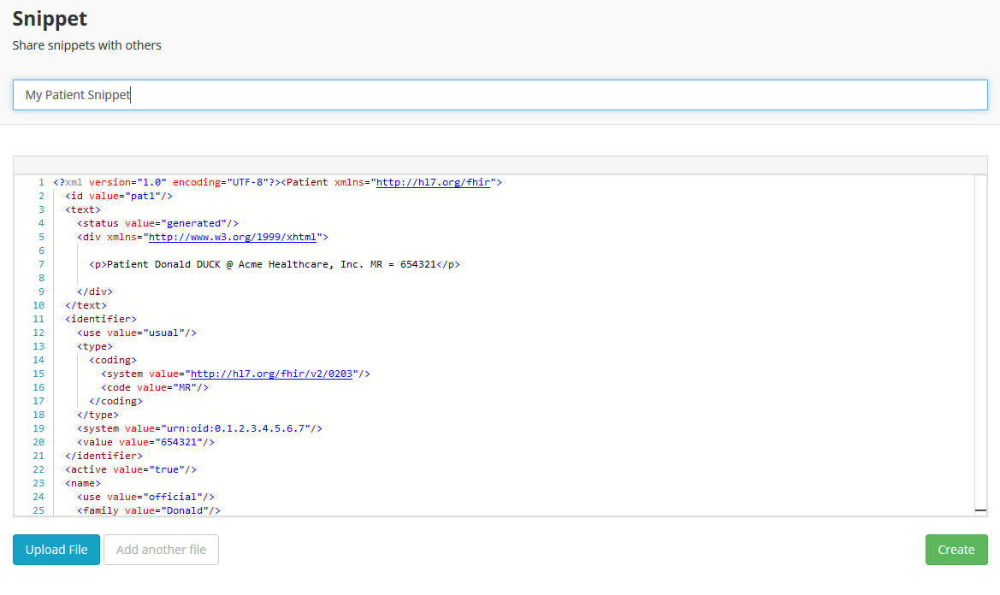
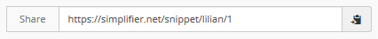
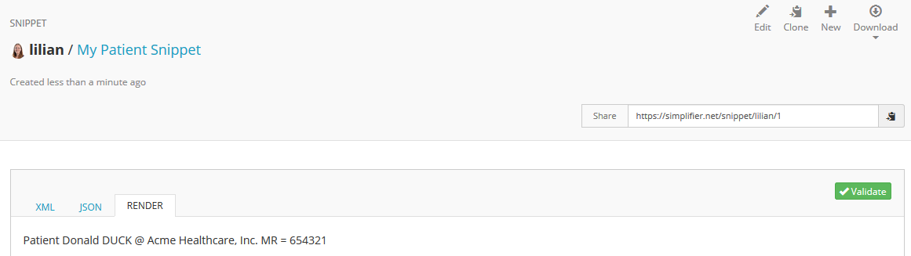
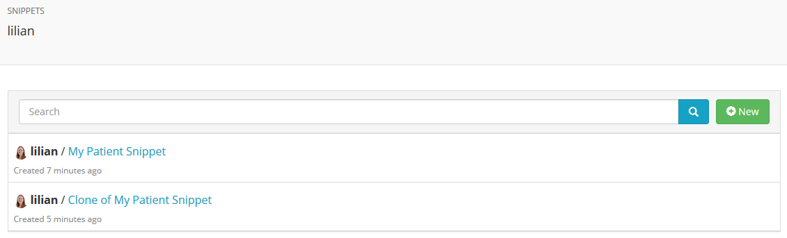

.. _snippets:

Snippets
========
The Snippet feature in Simplifier enables you to quickly share resources with another Simplifier user (e.g. for review purposes) without storing them in your project. To create one, click ``CREATE SNIPPET`` on the Simplifier homepage, or open ``Snippets`` from your personal menu and click ``Create``.

Start by giving your Snippet a title, e.g. MyPatient. You can either upload a file or copy-paste your XML code in the editor. Select ``Add another file`` to upload more than one resource within the same Snippet. When you are finished uploading and editing your resources, click on the ``Create`` button on the right.

Your Snippet will now be available on Simplifier. The URL is displayed at the top right of the Snippet. You can quickly copy the URL to your clipboard by clicking on the ``Copy`` icon at the right.

When visiting the URL of a Snippet, you can choose to view either the XML code, JSON code or the rendered resource by selecting one of the available tabs. In the top right menu you can either select ``Edit`` to edit the resource, ``Clone`` to copy it in a new Snippet, ``New`` to create a new Snippet or ``Download`` to download the resource as a XML or JSON file. You can also validate the resource by using the green ``Validate`` button at the right.

Personal Snippets
-----------------
Through your  `personal menu <simplifierPersonalContent.html#user-portal>`_ (click on your avatar at the top right and select ``Snippets``) you can access a list of all your Snippets. From here you can also quickly add a new Snippet by clicking the ``Create`` button.

